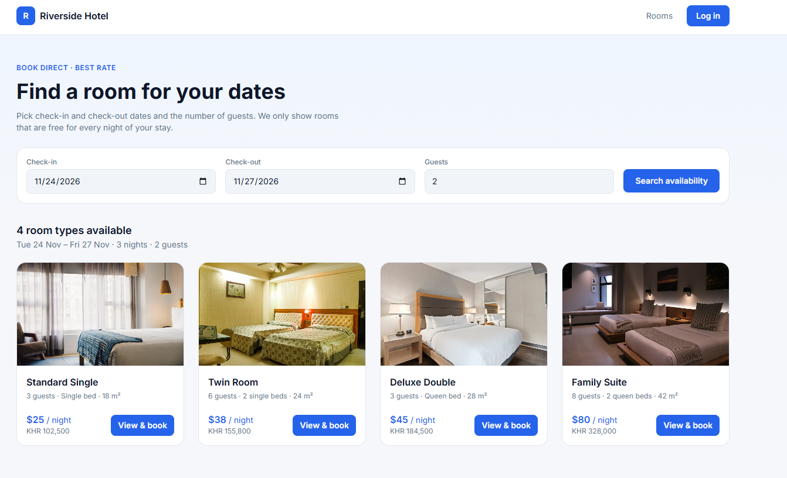
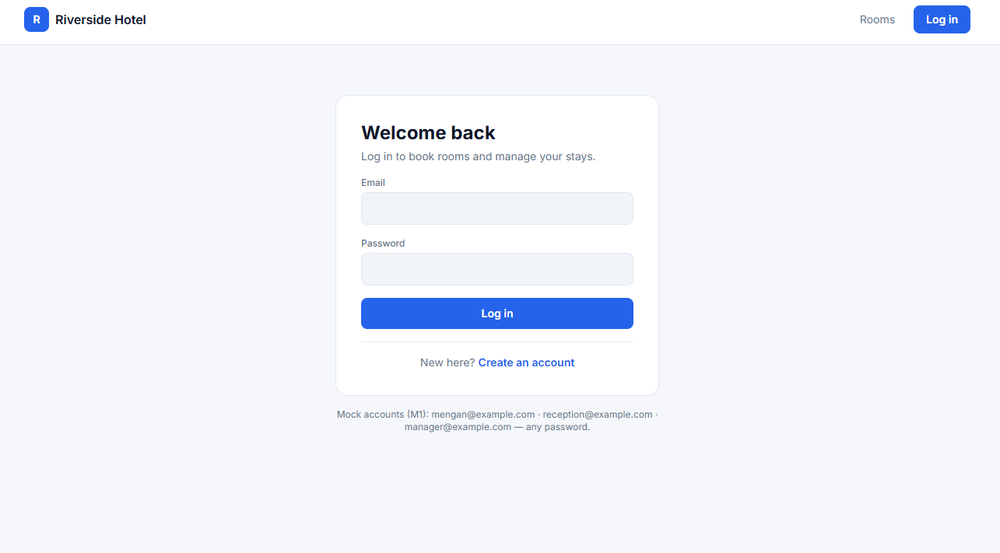
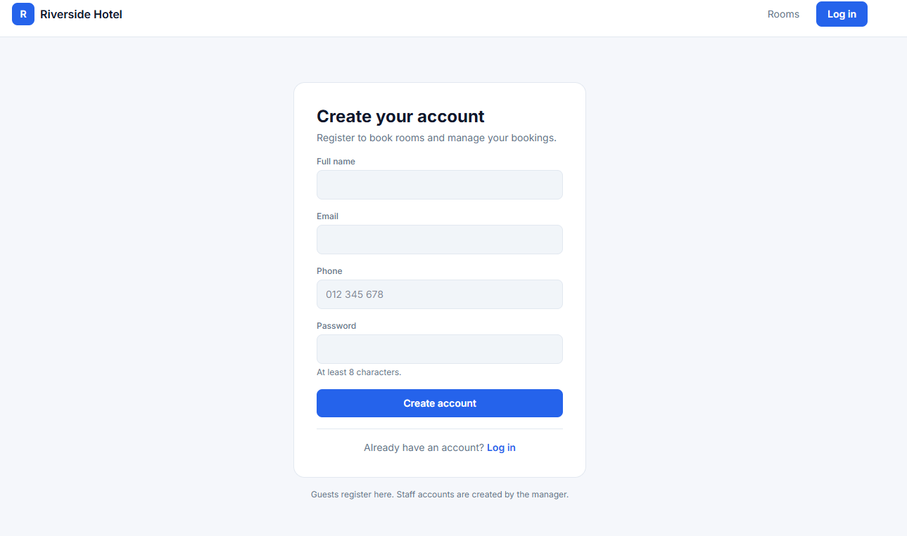
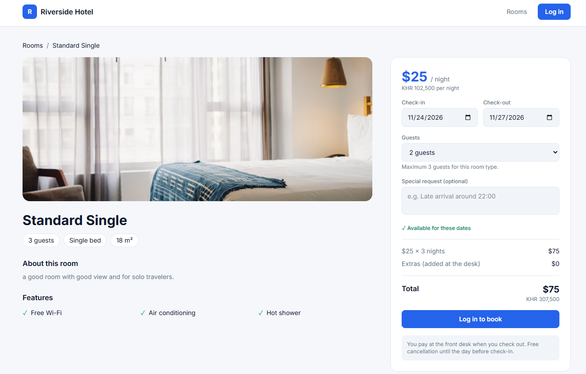

# Hotel Management System
A web application for a small hotel: guests search free rooms by date and book online, easy to use for new guests, receptioonists handle check-in and check-out.

## Screenshots

## Architecture:
- M1 (Frontend prototype): the Vue app talks to a mock api made with json-server: web (HTTP/JSON) -> json-server (service) -> db.json acts as a database for a time being

## Frontend structure:
web/src/:
 - views: one page per route (Home, Rooms, Room detail, My bookings, Login, Register, Not found)
 - components: reusable UI
 - services: code that use API to fetch data from json.
 - stores: Pinia stores (auth = logged-in user)
 - router: routes and the route gurard
 - types: create interface of each entity
 - utils: validation rules

 ## Running the project
- cd web/
- npm run dev (copy the link that it creates) and open http://localhost:5173
- npm run mock (run the api to fetch data)
- npm run type-check: check

## Environment variables
In web/src/services/api.ts

## Test accounts
| Role| Email| Password|
|---|---|---|
| Guest| mengan@example.com| |
| Receptionist|||

## Project Documents:
- PROPOSAL.md: problems, roles, user stories, MVP scope
- MILESTONES.md: answers per milestone
- AI_LOG.md: use AI and explanation
- docs/wireframes: draw the wireframe
